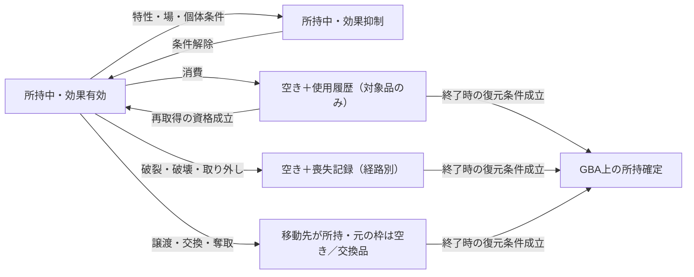

# 所持・消費・喪失の状態

## ITM-STATE-001

`SOURCE_CONFIRMED`。所持は `gBattleMons[battler].item`。 `GetBattlerHoldEffectInternal` は場にいない、控えとして技を使う、さしおさえ、マジックルーム、ぶきよう等で効果を抑制する。賞金効果への例外と、セーブ由来のe-Readerナゾのみの別経路がある。きんちょうかんは摂食を停止する。着脱可否は種族・相手・世代・品の組で判定。Z、メール、e-Reader、フォーム品、パラドックスとブーストエナジー、オーガポンの面に別分岐がある。[有効効果の解決](https://github.com/koziyagoukei/PokeEm-expansion-CanuseJP/blob/2d1e107ad820a3b0a601af968b49856f74151ee1/src/battle_util.c#L5915) · [IsUnnerveBlocked](https://github.com/koziyagoukei/PokeEm-expansion-CanuseJP/blob/2d1e107ad820a3b0a601af968b49856f74151ee1/src/battle_util.c#L455) · [CanBattlerGetOrLoseItem](https://github.com/koziyagoukei/PokeEm-expansion-CanuseJP/blob/2d1e107ad820a3b0a601af968b49856f74151ee1/src/battle_util.c#L9114)

## ITM-STATE-002

| 処理 | 実コードで確認した経路 |
|---|---|
| 消費 | `Cmd_removeitem` は加工した対象IDをパーティ側の `usedHeldItem` に記録する（例外あり）。はんすうタイマー、現在品の消去、かるわざ、拾得候補設定、コントローラ通知、きょうせい・ほおぶくろと続く。Fling再入や強制摂食で二度外さない。[Cmd_removeitem](https://github.com/koziyagoukei/PokeEm-expansion-CanuseJP/blob/2d1e107ad820a3b0a601af968b49856f74151ee1/src/battle_script_commands.c#L4521) |
| 破壊・喪失 | ふうせんの破裂と腐食は通常の使用履歴へ記録しない。やきつくすは専用経路。はたきおとすは世代によって無効化か実除去。攻撃時の補正と実際の取り外しは別の判定。[Incinerate](https://github.com/koziyagoukei/PokeEm-expansion-CanuseJP/blob/2d1e107ad820a3b0a601af968b49856f74151ee1/src/battle_set_effect.c#L452) · [Knock Offの威力条件](https://github.com/koziyagoukei/PokeEm-expansion-CanuseJP/blob/2d1e107ad820a3b0a601af968b49856f74151ee1/src/battle_util.c#L6725) |
| 交換・譲渡・奪取 | 交換は両側の取得・着脱可否を検査。身代わり、ねんちゃく、空き、戦闘種別で経路が異なる。くっつきバリはねんちゃくを確認しない移動経路を持つ。[交換の四方向判定](https://github.com/koziyagoukei/PokeEm-expansion-CanuseJP/blob/2d1e107ad820a3b0a601af968b49856f74151ee1/src/battle_script_commands.c#L7184) · [くっつきバリ](https://github.com/koziyagoukei/PokeEm-expansion-CanuseJP/blob/2d1e107ad820a3b0a601af968b49856f74151ee1/src/battle_hold_effects.c#L532) · [CanStealItem](https://github.com/koziyagoukei/PokeEm-expansion-CanuseJP/blob/2d1e107ad820a3b0a601af968b49856f74151ee1/src/battle_util.c#L9667) |
| 再取得・再発動 | リサイクル・しゅうかくは空きと履歴を読む。ものひろいには別個体と拾得資格が必要。はんすうはタイマーと履歴から再摂食する。[リサイクルの使用履歴](https://github.com/koziyagoukei/PokeEm-expansion-CanuseJP/blob/2d1e107ad820a3b0a601af968b49856f74151ee1/src/battle_script_commands.c#L7856) · [ものひろい・しゅうかく](https://github.com/koziyagoukei/PokeEm-expansion-CanuseJP/blob/2d1e107ad820a3b0a601af968b49856f74151ee1/src/battle_util.c#L3791) · [はんすう](https://github.com/koziyagoukei/PokeEm-expansion-CanuseJP/blob/2d1e107ad820a3b0a601af968b49856f74151ee1/src/battle_util.c#L3965) |
| 交代・ひんし | 所持と再取得用履歴は場の位置から分離。ひんしで空き枠になることは品の喪失を意味しない。ゴツゴツメット等には所持者のひんし後も動く場面がある。[コントローラ同期](https://github.com/koziyagoukei/PokeEm-expansion-CanuseJP/blob/2d1e107ad820a3b0a601af968b49856f74151ee1/src/battle_script_commands.c#L4554) · [ひんし後の例外](https://github.com/koziyagoukei/PokeEm-expansion-CanuseJP/blob/2d1e107ad820a3b0a601af968b49856f74151ee1/src/battle_hold_effects.c#L1034) |
| 戦闘終了 | `LostItem` はトレーナーとパーティ枠で管理する。原品、`stolen`、`restoreAfterBattle`、野生品取得を分ける。復元ループで対象の原品を戻し、きのみを除外する。捕獲には個別経路がある。[復元フラグとTryRestoreHeldItems](https://github.com/koziyagoukei/PokeEm-expansion-CanuseJP/blob/2d1e107ad820a3b0a601af968b49856f74151ee1/src/battle_util.c#L9582) · [終了時の呼び出し](https://github.com/koziyagoukei/PokeEm-expansion-CanuseJP/blob/2d1e107ad820a3b0a601af968b49856f74151ee1/src/battle_main.c#L5531) |

既定の `B_KNOCK_OFF_DMG`、`B_KNOCK_OFF_REMOVAL`、`B_RESTORE_HELD_BATTLE_ITEMS` はGEN_9、`B_TRAINERS_KNOCK_OFF_ITEMS` はTRUE。[Knock Offの威力設定](https://github.com/koziyagoukei/PokeEm-expansion-CanuseJP/blob/2d1e107ad820a3b0a601af968b49856f74151ee1/include/config/battle.h#L36) · [実除去設定](https://github.com/koziyagoukei/PokeEm-expansion-CanuseJP/blob/2d1e107ad820a3b0a601af968b49856f74151ee1/include/config/battle.h#L145) · [トレーナー設定と復元](https://github.com/koziyagoukei/PokeEm-expansion-CanuseJP/blob/2d1e107ad820a3b0a601af968b49856f74151ee1/include/config/battle.h#L253)

## ITM-STATE-003

`SOURCE_CONFIRMED`。GCはロスター個体の `item_from` で品を引き、消費でNULLにして `item_used`・タイミング・ターンを記録する。開始時の `BattleEntry.record.held_item` は残る。V19には履歴からの再取得、個体別抑制、喪失の理由、着脱制約、持ち物変更の永続反映がない。[Battlerの所持状態](https://github.com/koziyagoukei/gba-gc-extension/blob/44c51538c7e5efbeb27bee91d5cc8a0a89cab14b/gamecube/battle/battle_core.h#L86) · [消費と履歴](https://github.com/koziyagoukei/gba-gc-extension/blob/44c51538c7e5efbeb27bee91d5cc8a0a89cab14b/gamecube/battle/battle_items.c#L112)

`INFERRED`（B2案）。品定義と品インスタンスを分け、原所有者と現在所有者、個体ごとの使用履歴・再取得資格を保持する。有効性は場・個体・特性から導出し、消費・破壊・除去・移動・再取得は別イベントにする。戦闘終了時の復元と永続化はGBA上のResult Policyで決める。
